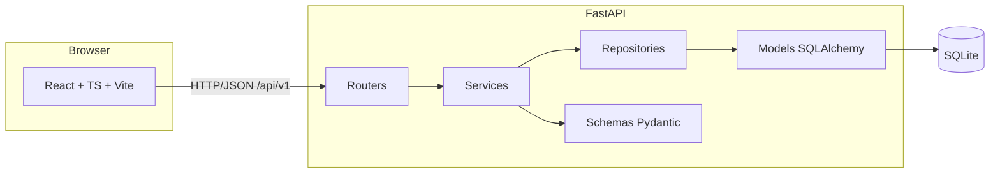

# Arquitetura — AgendaPro

## 1. Visão geral
SPA React consome API REST FastAPI; persistência em SQLite via SQLAlchemy.



## 2. Camadas do back-end
| Camada | Responsabilidade | Não pode |
|--------|------------------|----------|
| `routers` | HTTP, validação de schema, códigos de status, dependências de auth | Conter regra de negócio ou SQL |
| `services` | Regras de negócio (conflito, transições de status, disponibilidade) | Conhecer FastAPI/HTTP |
| `repositories` | Acesso a dados (queries SQLAlchemy) | Decidir regra de negócio |
| `models` | Entidades ORM | Lógica de aplicação |
| `schemas` | Contratos de entrada/saída (Pydantic) | Acessar banco |
| `core` | Config, segurança (hash/JWT), erros, dependências | — |

Exceções de domínio (`ScheduleConflictError`, `InvalidTransitionError`, `NotFoundError`) são convertidas em respostas HTTP por um handler central.

## 3. Camadas do front-end
`pages` (telas) → `components` (UI reutilizável) → `hooks` (React Query/estado) → `api` (cliente HTTP tipado) → `types`. Rotas: área pública (`/reservar`) e área administrativa (`/admin/*`) protegida por `ProtectedRoute`.

## 4. Decisões arquiteturais (ADR resumidas)
| ID | Decisão | Motivo | Consequência |
|----|---------|--------|--------------|
| ADR-01 | SQLite no MVP | Zero configuração, ideal para avaliação | Concorrência limitada; schema compatível com PostgreSQL |
| ADR-02 | Alembic para migrações | Modelo de dados versionado | Dependência extra; ganho em rastreabilidade |
| ADR-03 | JWT em header `Authorization: Bearer` | Simples para SPA | Armazenar token em memória/sessionStorage; sem refresh no MVP |
| ADR-04 | Conflito validado no service **e** protegido por transação | Evitar corrida na reserva pública | Verificar dentro de `BEGIN IMMEDIATE` |
| ADR-05 | Horários em UTC no banco | Evita ambiguidade | Conversão na borda (front) |
| ADR-06 | React Query para dados remotos | Cache e estados de loading/erro | Dependência extra |
| ADR-07 | Exclusão lógica (`active`) para serviços/profissionais | Preservar histórico | Filtros `active=true` nas listagens públicas |

## 5. Estrutura de diretórios proposta
```
projeto_facul/
├─ README.md
├─ docs/                      # planejamento e evidências (este conjunto)
├─ backend/
│  ├─ pyproject.toml          # ou requirements.txt
│  ├─ alembic/ , alembic.ini
│  ├─ app/
│  │  ├─ main.py
│  │  ├─ core/        (config.py, security.py, errors.py, deps.py)
│  │  ├─ db/          (session.py, base.py, seed.py)
│  │  ├─ models/      (user, client, service, professional, availability, appointment)
│  │  ├─ schemas/
│  │  ├─ repositories/
│  │  ├─ services/    (auth, client, service, professional, availability, appointment, slot, dashboard)
│  │  └─ routers/     (auth, clients, services, professionals, availability, appointments, dashboard, public)
│  └─ tests/
│     ├─ unit/  integration/  conftest.py
├─ frontend/
│  ├─ package.json, vite.config.ts, tsconfig.json
│  ├─ src/ (api, components, hooks, pages/{admin,public}, routes, types, styles)
│  └─ e2e/                    # Playwright
└─ .github/workflows/ci.yml   # criado, mas NÃO executado até autorização
```

## 6. Segurança
Hash de senha, JWT com expiração (60 min), CORS restrito à origem do front, rate limit simples no login (opcional), segredos via `.env` (nunca versionado; `.env.example` versionado), endpoints públicos limitados a `/public/*`.

## 7. Ambiente e execução (planejado)
Back: `uvicorn app.main:app --reload` (porta 8000). Front: `npm run dev` (5173, proxy para `/api`). Seed fictício via `python -m app.db.seed`.
