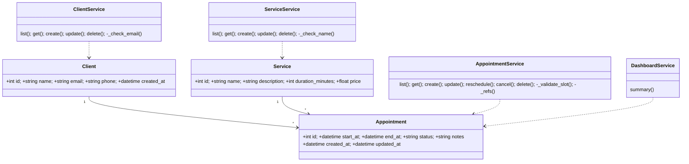
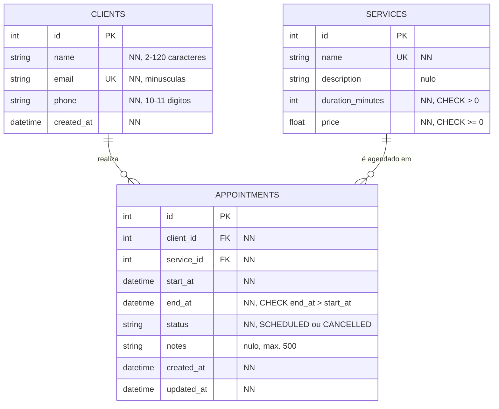

# Modelo de dados

## Diagrama de classes

## DER

## Dicionário de dados
### clients
| Coluna | Tipo | Restrições | Descrição |
|---|---|---|---|
| id | INTEGER | PK | Identificador |
| name | VARCHAR(120) | NN, 2–120 chars (validação) | Nome |
| email | VARCHAR(120) | NN, UNIQUE | E-mail (minúsculas) |
| phone | VARCHAR(15) | NN, 10–11 dígitos (validação) | Telefone só dígitos |
| created_at | DATETIME | NN | Criação |

### services
| Coluna | Tipo | Restrições | Descrição |
|---|---|---|---|
| id | INTEGER | PK | |
| name | VARCHAR(100) | NN, UNIQUE | Nome |
| description | TEXT | nulo | |
| duration_minutes | INTEGER | NN, CHECK > 0 (+ regra 15–480, múltiplo de 15) | Duração |
| price | FLOAT | NN, CHECK ≥ 0 | Preço de referência (sem cobrança) |

### appointments
| Coluna | Tipo | Restrições | Descrição |
|---|---|---|---|
| id | INTEGER | PK | |
| client_id | INTEGER | FK clients.id, NN | |
| service_id | INTEGER | FK services.id, NN | |
| start_at | DATETIME | NN | Início (horário local) |
| end_at | DATETIME | NN, CHECK end_at > start_at | Início + duração |
| status | VARCHAR(12) | NN, CHECK in (SCHEDULED, CANCELLED) | |
| notes | TEXT | nulo, máx. 500 (validação) | |
| created_at, updated_at | DATETIME | NN | Auditoria |

Índice `ix_appointments_range (start_at, end_at)` para a consulta de conflito. Chaves estrangeiras ativadas com `PRAGMA foreign_keys=ON`.
