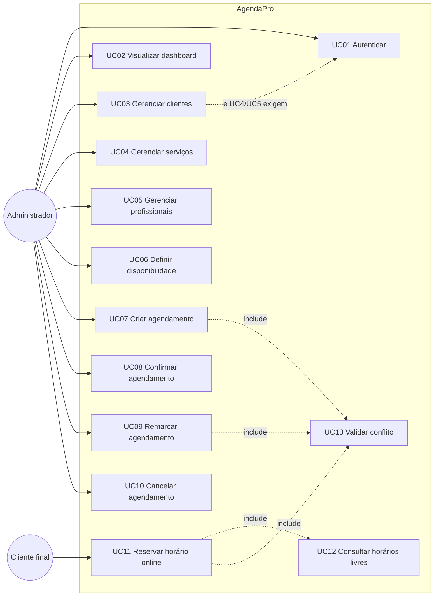
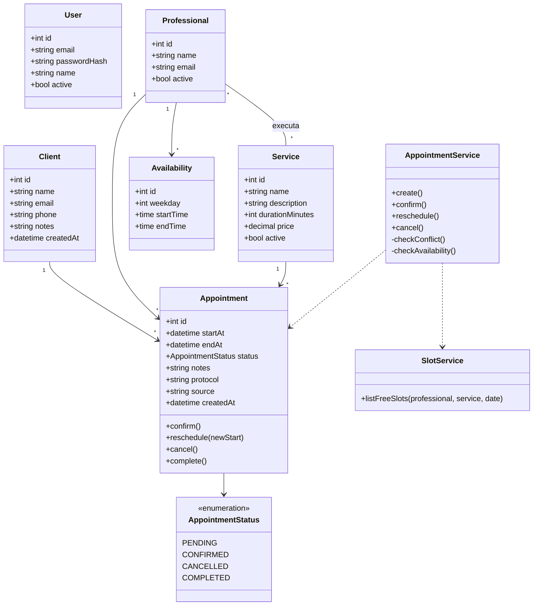
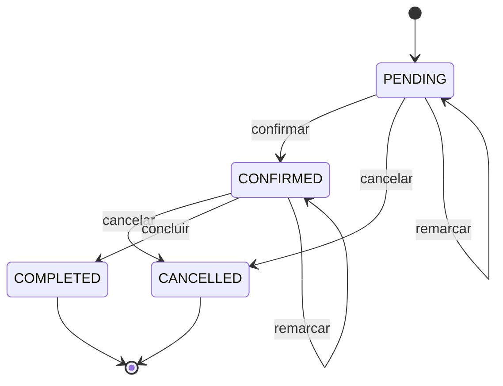
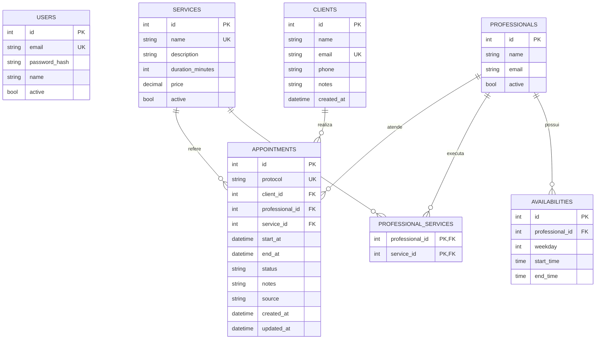

# Diagramas UML e ER (Mermaid)

Diagramas em Mermaid para serem versionados e renderizados no GitHub. Exportar para PNG/SVG para a entrega acadêmica, se exigido.

## 1. Casos de uso

| UC | Ator | Pré-condição | Fluxo principal | Alternativos |
|----|------|--------------|-----------------|--------------|
| UC07 | Admin | Autenticado; cliente, serviço, profissional existem | Seleciona cliente, serviço, profissional, data/hora → sistema calcula fim, valida → cria PENDING | Conflito → 409; fora da disponibilidade → 422 |
| UC11 | Cliente | Serviço ativo existe | Serviço → profissional → data → horário → dados → protocolo | Horário tomado → 409, volta à escolha |
| UC09 | Admin | Agendamento PENDING/CONFIRMED | Escolhe novo horário → valida → atualiza | Conflito → mantém original |

## 2. Diagrama de classes

### Transições de status

## 3. Entidade-relacionamento

